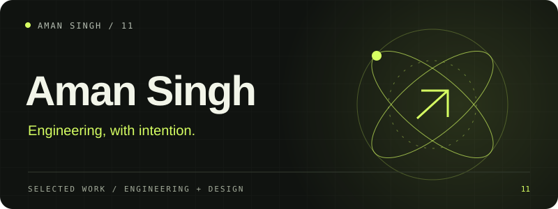

# Aman Singh

[Live portfolio](https://aman-portfolio-silk.vercel.app/) · [Development guide](DEVELOPMENT.md)

My personal portfolio, pairing motion-led storytelling with scoped project case studies and an accessible responsive interface.

**React / TypeScript / GSAP / Vite**

## What is included

Includes the current project collection, experience, filters, project dialogs and resume download. This GitHub refresh publishes the current working source while retaining the repository's private visibility.

## Local setup

Run `npm ci`, `npm run typecheck` and `npm run build`. Use `npm run dev` for local development. The static output is written to `dist/`.

## Source and configuration

This repository is a source release. Local credentials, session cookies, personal records, databases, dependency directories and generated build files are excluded. See [SECURITY.md](SECURITY.md) before configuring integrations or contributing.

Current integration availability and physical-device behavior must be verified in your own environment. Historical project checks are not a promise that every external service works today.

---

Built by [Aman Singh](https://github.com/aman-singh27) · [More work](https://github.com/aman-singh27/aman-singh27/blob/main/PROJECTS.md)
